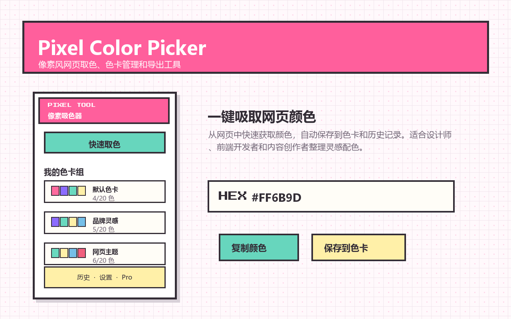
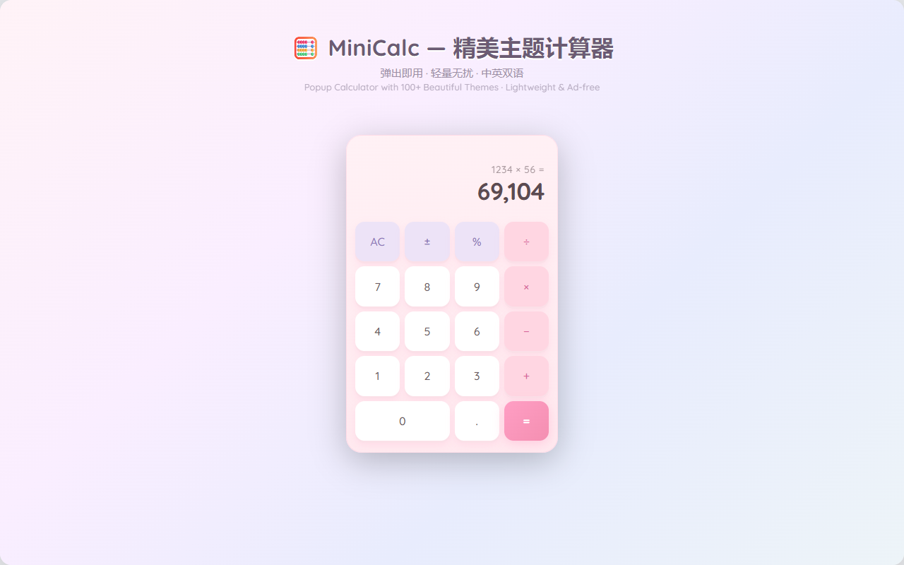

# Chrome 扩展商店素材生成器 | Chrome Extension Store Asset Generator

> 一键生成 Chrome Web Store 商店截图与宣传图（PNG/JPG），并完成严格的视觉 QA
> One-click Chrome Web Store screenshots & promo images (PNG/JPG) with strict visual QA

<p align="center">
  <a href="LICENSE"></a>
  
  
</p>

**关键词 / Keywords:** Chrome 扩展 · 商店截图 · 宣传图 · Chrome Web Store · screenshot generator · promo image · CodeBuddy skill · Pillow

> **中文** | [English](#english-version)

一个可复用的 **用户级** CodeBuddy Skill，基于 PIL 的 Python 流水线为浏览器扩展 / Web 应用项目生成 Chrome Web Store 截图和宣传图（PNG/JPG），并在交付前强制通过 **综合视觉 QA + 本地化规则**。

A reusable **user-level** CodeBuddy skill that generates Chrome Web Store screenshots and promotional images (PNG/JPG) for browser-extension / web-app projects with a PIL-based Python pipeline, then enforces a strict **comprehensive visual QA + localization** checklist before delivery.

---

## 效果预览 | Preview

以下图片由本 Skill 根据真实扩展的 **UI 风格与功能**生成，并已通过视觉 QA。

> Generated by this skill from the **actual UI style and features** of real extensions, and passed visual QA.

### Pixel Color Picker

<p align="center">
  
</p>

### MiniCalc

<p align="center">
  
</p>

---

## 功能 | Features

- 生成 **1280×800 商店截图**（按语言分两套）与 **440×280 / 1400×560 宣传图**（中英双语同图）。
- **可选**像素风字体 `assets/PressStart2P-Regular.ttf`，适合复古 SaaS 视觉；缺失时自动回退到系统字体。
- 内置 `popup_mock` 组件，支持等比缩放，小尺寸自动切换更小字号（scale-aware）。
- 英文/长文案按 **词边界 + CJK 字符** 换行，避免单词被截断（如 `hi story`）。
- 导出卡等网格强制 **偶数 2×N / 3×N**，杜绝「孤儿行」。
- 强制 **生成 → 预览 → 修复 → 重生成** 工作流，确保每张素材都通过 综合视觉 QA + 本地化规则。

- Generates **1280×800 store screenshots** (per-language sets) and **440×280 / 1400×560 bilingual promo tiles**.
- **Optional** pixel-art font `assets/PressStart2P-Regular.ttf` for a retro SaaS look; falls back to system fonts when omitted.
- Built-in `popup_mock` component with scale-aware font sizing (smaller fonts at small sizes).
- Word-aware wrapping for English / long copy (no broken words like `hi story`).
- Even 2×N / 3×N card grids — no orphan rows.
- Enforces a **generate → preview → fix → regenerate** loop so every asset passes 9 visual QA rules + localization rules.

---

## 项目结构 | Folder Structure

```
chrome-extension-store-asset-generator/
├── SKILL.md                              # skill 触发 + 工作流（CodeBuddy 必需）
├── scripts/
│   ├── generate-store-screenshots.py    # 1280×800 截图生成器（zh / en 各一套）
│   └── generate-store-promo.py          # 440×280 + 1400×560 双语宣传图生成器
├── references/
│   └── qa-checklist.md                   # 综合视觉 QA + 本地化 + 硬性规则（emoji 禁令/纯色背景/灰底阴影/440×280 铁律/对比度/对齐基准/强制自检闭环）
├── examples/                             # 真实项目生成效果预览
│   ├── color-picker-screenshot-01.png
│   └── minicalc-shot1-main.png
├── assets/
│   └── PressStart2P-Regular.ttf          # 示例像素字体（可选）
├── requirements.txt                       # 依赖
├── LICENSE                                # MIT
└── README.md
```

**生成产物默认落点（位于目标项目内）：**

```
<project>/store-assets/
├── screenshots/
│   ├── zh/   # 5 张全中文截图（1280×800）
│   └── en/   # 5 张全英文截图（1280×800）
└── promo/
    ├── promo-small-440x280.png   # 中英双语
    └── promo-large-1400x560.png  # 中英双语
```

---

## 环境要求 | Prerequisites

- Python 3.10+
- Pillow：

```bash
python3 -m pip install -r requirements.txt   # Windows 用户改用 py -3
```

> 运行脚本：macOS/Linux 用 `python3`，Windows 用 `py -3`（本机 `python3`/`python` 均无法正常使用）。脚本会优先使用 `<project>/fonts/PressStart2P-Regular.ttf`，否则回退到项目内 `assets/` 或系统自带的 `msyh.ttc` / `simhei.ttf`。

---

## 用法 | Usage

将该 Skill 复制到 CodeBuddy 用户级 Skill 目录：

```powershell
Copy-Item . "$env:USERPROFILE\.codebuddy\skills\chrome-extension-store-asset-generator" -Recurse -Force
```

在目标项目中运行脚本（产物默认输出到 `<project>/store-assets/`）：

```bash
# 截图：按语言分两套，输出到 store-assets/screenshots/{zh,en}/
python3 scripts/generate-store-screenshots.py   # Windows 用 py -3

# 宣传图：中英双语同图，输出到 store-assets/promo/{promo-small-440x280,promo-large-1400x560}.png
python3 scripts/generate-store-promo.py          # Windows 用 py -3
```

生成后请对照 `references/qa-checklist.md` 逐项检查，发现问题后修改脚本参数并重新生成，直到全部通过。

---

## 视觉 QA 标准 | Visual QA Standard

所有生成素材必须满足 `references/qa-checklist.md` 中的检查项（综合视觉 QA + 本地化 + 硬性规则）：

1. 字号必须随画布缩放（scale-aware）。
2. Banner 标题与副标题必须留 ≥ 8px 间隙，副标题在框内。
3. 卡片网格必须偶数、整齐（2×N 或 3×N）。
4. 底部边距安全线：元素底边 < 画布高度 − 12px。
5. 相邻区块不得重叠。
6. 小节标题与内容间距 ≥ 20px。
7. 每轮改动后必须重新生成并自行预览（生成 → 预览 → 修复 → 重生成）。
8. 按钮内文字必须垂直居中 + 自适应缩小（promo CTA 双语文案，按按钮高度居中，过大则缩小字号）。
9. 长文案必须按词换行/精简，避免被截断遮挡（尤其英文更长）。

**额外硬性规则（来自全局用户规则，详见 `references/qa-checklist.md`）：**

- **禁 emoji / 非标准 Unicode 符号**：PIL 渲染 emoji 与 ✦▽➤◆ 等会成 □ 方框；改用几何图形，中文须用 `font_zh`。
- **背景纯色**：禁网格线 / 圆点阵列等密集图案（密集恐惧症）。
- **底色必须异于画面中任何色卡/主题色**：背景不得与画面里出现的色块色值相同，否则卡片会融成空框；必要时用派生色并加 `assert`。
- **灰底 / 阴影防护**：禁 `surface2`，外层卡片 `shadow=False`，避免灰色光晕。
- **对比度 ≥ WCAG AA 4.5:1**：按钮 / 关键文字须深底白字或白底深字。
- **440×280 小型宣传图铁律**：popup scale ≤ 0.30、feature 用圆点 + 文字（禁卡片容器）、≤ 3 行 feature + 1 CTA。
- **对齐基准线统一**：所有区块共用同一条左右边距，banner 右缘 = 末列右缘，列间距 ≥ 20px。
- **重绘不 patch**：改脚本全量重生成；相对路径输出防 Windows 中文路径 `OSError 22`。
- **强制逐张自检闭环**：用 `read_file` (CodeBuddy) / `Read` (Claude Code) / `read` (Codex) 打开每张 PNG，10 项自检全过才交付。

**本地化规则（硬性）：**

- 截图按语言分两套：`store-assets/screenshots/{zh,en}/`，中文图 **全中文**、英文图 **全英文**，绝不混语。
- 宣传图必须中英双语同一张图：`store-assets/promo/`（不分 `zh`/`en` 子目录）。
- mockup 动态文案随截图语言切换（用 `lang` 字典驱动，不写死英文占位符）。
- 手绘卡片改行数/文案后必须重算依赖坐标（按钮 Y、卡片高度、内部间距）。
- promo CTA 中英用中点 `·` 分隔（如 `立即体验 · Try It Now`）。

---

## 应用示例 | Real-world Examples

该 Skill 已用于生成以下项目的 Chrome 商店素材：

- **Pixel Color Picker**：截图 + 440×280 / 1400×560 宣传图。
- **MiniCalc**：含截图、small tile、marquee 等多种尺寸素材。

---

## 安装为 CodeBuddy Skill | Install as CodeBuddy Skill

```powershell
# 复制到用户级 skill 目录
Copy-Item . "$env:USERPROFILE\.codebuddy\skills\store-asset-generator" -Recurse -Force
```

之后，只要你说「生成商店截图 / 宣传图」或提到 `generate-store-screenshots.py`，该 Skill 就会自动触发。

---

## 在其他 Agent（Claude Code / Codex）中使用 | Use with Claude Code / Codex

本 Skill 遵循开放的 **Agent Skills** 规范（`SKILL.md` 含 `name` / `description` frontmatter，
且已是标准目录结构），可直接用于 Claude Code 与 OpenAI Codex，脚本与 QA 清单三端共用，
无需任何改动。

- **Claude Code**（个人级）：把整个 `store-asset-generator/` 文件夹复制到
  `~/.claude/skills/store-asset-generator/`（项目级放 `<repo>/.claude/skills/store-asset-generator/`）。
  之后用 `/store-asset-generator` 触发，或自然语言描述「生成商店截图 / 宣传图」自动匹配。
- **Codex（OpenAI）**：复制到 `~/.codex/skills/store-asset-generator/`
  （项目级 `<repo>/.codex/skills/store-asset-generator/`）。Codex 按 `description` 自动匹配。

> 跨 Agent 差异只在两处：① 预览 PNG 的工具名不同（CodeBuddy `read_file` / Claude Code `Read` / Codex `read`）；
> ② 运行脚本的 Python 启动器（macOS/Linux `python3` / Windows `py -3`）。其余 `scripts/`、`references/` 完全一致。

---

## 许可证 | License

[MIT](LICENSE) © 2026 [vaxicy](https://github.com/vaxicy)

---

## English Version

### What it does

A reusable CodeBuddy skill for generating Chrome Web Store screenshots and promotional images. It bundles two Python scripts that draw the assets with PIL, plus a strict **comprehensive visual QA + localization** checklist to catch overflow, misalignment, and spacing issues before delivery.

### Features

- Generates **1280×800 store screenshots** (per-language sets) and **440×280 / 1400×560 bilingual promo tiles**.
- Pixel-art font (`assets/PressStart2P-Regular.ttf`) for a retro SaaS look; falls back to system fonts.
- Scale-aware `popup_mock` component switches to smaller fonts at small sizes.
- Word-aware wrapping for English / long copy (no broken words).
- Even 2×N / 3×N card grids — no orphan rows.
- Enforces a mandatory **generate → preview → fix → regenerate** loop.

### Prerequisites

- Python 3.10+
- `Pillow` (install via `python3 -m pip install -r requirements.txt`; Windows: `py -3 -m pip install -r requirements.txt`)

> Run scripts with `python3` on macOS/Linux, or `py -3` on Windows.

### Usage

Copy the skill into your CodeBuddy user skills directory:

```powershell
Copy-Item . "$env:USERPROFILE\.codebuddy\skills\chrome-extension-store-asset-generator" -Recurse -Force
```

Run the scripts from your project root (assets default to `<project>/store-assets/`):

```bash
py -3 scripts/generate-store-screenshots.py  # per-language sets → store-assets/screenshots/{zh,en}/
py -3 scripts/generate-store-promo.py        # bilingual tiles → store-assets/promo/
```

After generation, inspect every PNG against `references/qa-checklist.md`, fix the script parameters, and regenerate until all checks pass.

### Localization rules (hard)

- Screenshots split per language: `store-assets/screenshots/{zh,en}/` — a `zh` shot is fully Chinese, an `en` shot fully English.
- Promo tiles are bilingual (Chinese + English in one image) under `store-assets/promo/` (no language subdirs).
- Mockup "dynamic" copy follows the screenshot language via a `lang` dictionary.
- Hand-drawn cards must recompute downstream coordinates after edits.
- Promo CTA separates Chinese/English with a middot `·`.

### License

[MIT](LICENSE) © 2026 [vaxicy](https://github.com/vaxicy)
